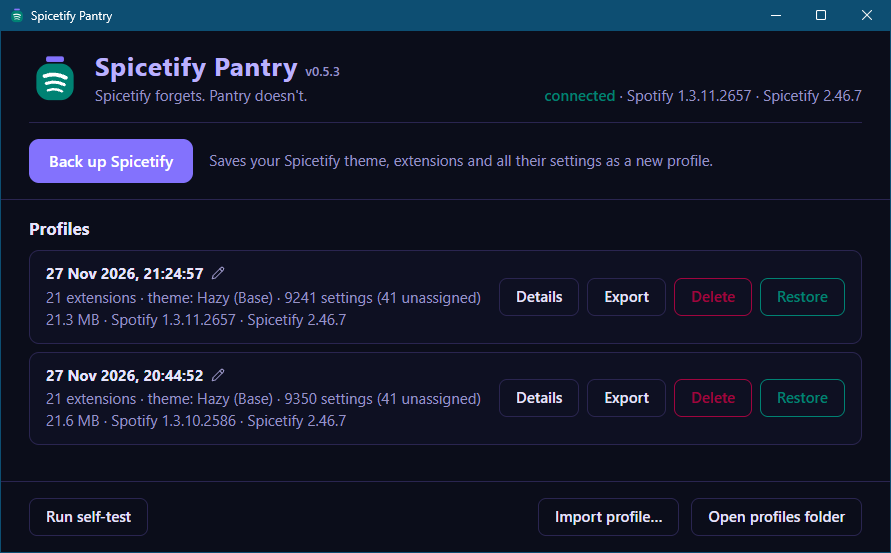

# Spicetify Pantry

Spicetify forgets. Pantry doesn't.

Spicetify Pantry is my Windows app. It backs up and restores Spicetify extensions **and their settings** from outside Spotify, so nothing is lost when Spotify updates, Spicetify breaks or Spicetify is removed. Spicetify's own backup keeps the extension list, but Marketplace installs and every extension setting live only inside Spotify's browser storage. Pantry backs those up too.

## Download

Get the latest installer from [Releases](https://github.com/VoidCrowned/spicetify-pantry/releases/latest). Pantry updates itself after that.

Needs the regular Spotify installer (not the Microsoft Store version) and Spicetify. Pantry isn't code-signed, so SmartScreen asks first (More info → Run anyway), and Smart App Control blocks it.

## Use

- **Start Spotify** opens Spotify through Pantry, then **Back up Spicetify** saves a profile.
- **Restore** puts a profile back, after saving your current setup first.
- **Export** / **Import** move a profile to another PC.

Profiles stay in `%APPDATA%\Spicetify Pantry\profiles`. They can contain API tokens that extensions store, so think before sharing one.

## Building

From WSL: `npm install`, then `scripts/build-win.sh`. `scripts/release.sh <notes.md>` publishes a release. `pantry.exe --cli self-test <out.json>` runs the self-test without the window.

## Licence
Copyright © 2026 VoidCrowned. This program is free software. It comes without any warranty, to the extent permitted by applicable law. You can redistribute it and/or modify it under the terms of the Do What The Fuck You Want To Public License, Version 2, as published by Sam Hocevar. See [LICENSE](LICENSE) or http://www.wtfpl.net/ for more details.
